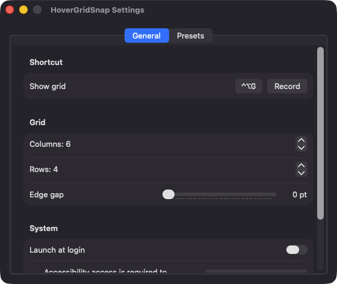
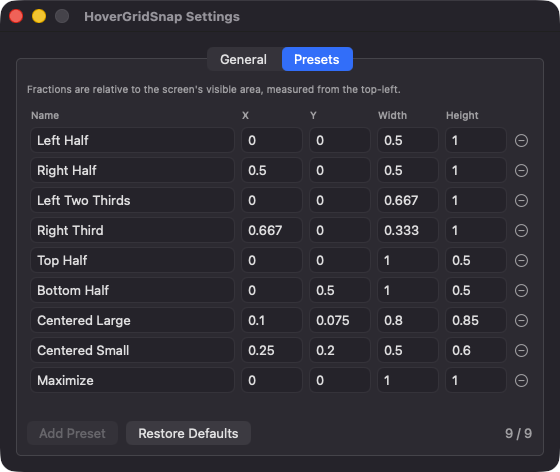

# HoverGridSnap

**🌐 Website:** [turhe123.github.io/hover-grid-snap](https://turhe123.github.io/hover-grid-snap/)

Hover a hotkey to pop up a small grid and click cells to snap the front window anywhere.


## Why

HoverGridSnap is a free, open-source, 100% native, backend-free alternative to paid utilities in the *Window Management* category. It was inspired by the grid idea in Moom ($15 one-time), and focuses on one thing: a compact pop-up grid where you click or drag across cells to define the window's rectangle. No accounts, no network access, no telemetry.

## Features

- **Global hotkey** (default `⌃⌥G`, registered via Carbon `RegisterEventHotKey`) toggles a small floating grid panel centered under the mouse pointer.
- **Click or drag** across cells to choose a rectangle; releasing the mouse snaps the focused window of the frontmost app.
- **Configurable grid**: 1–12 columns and 1–12 rows (default 6 × 4).
- **Live preview**: a translucent, click-through overlay shows where the window will land.
- **Up to nine named presets** (Left Half, Right Half, Left Two Thirds, Right Third, Top Half, Bottom Half, Centered Large, Centered Small, Maximize by default), each a fractional rectangle you can edit. Apply them from the menu bar menu (keys 1–9) or the grid panel footer.
- **Multi-display aware**: windows are placed on the screen under the mouse pointer, respecting the menu bar and Dock (visible frame). Works in points, so mixed Retina/non-Retina setups behave.
- **Edge gap** slider (0–40 pt) between the window and the screen edge.
- **Hotkey recorder** in Settings, with inline errors if the shortcut is unavailable.
- **Launch at login** toggle (via `SMAppService`).
- **Menu bar only**: no Dock icon. Esc or clicking outside closes the grid.
- **Safe handling of edge cases**: full-screen windows or missing focused windows beep and are skipped; windows that refuse a size are pulled back on screen; the panel closes when displays change.

## Screenshots

<p align="center"></p>

<p align="center"><em>The General settings tab, where you record the global hotkey (default ⌃⌥G), choose the grid&#x27;s columns and rows, and set the edge gap.</em></p>

<p align="center"></p>

<p align="center"><em>The Presets tab lists the nine default snap layouts as fractional rectangles you can edit, add or restore.</em></p>

## Install

1. Download `HoverGridSnap-macOS.zip` from the [latest release](https://github.com/turhe123/hover-grid-snap/releases/latest).
2. Unzip it and move `HoverGridSnap.app` to `/Applications`.
3. Because the app is open source and not notarized, clear the quarantine flag:

   ```bash
   xattr -cr /Applications/HoverGridSnap.app
   ```

4. Right-click the app → **Open** the first time.

## Build from source

Requires macOS 14+ and Xcode with Swift 5.9+.

```bash
brew install xcodegen
xcodegen generate
xcodebuild -project HoverGridSnap.xcodeproj -scheme HoverGridSnap -configuration Release -derivedDataPath ./build build
```

The app is produced at `build/Build/Products/Release/HoverGridSnap.app`.

## Permissions

- **Accessibility** (required): used through the `AXUIElement` API to read the focused window of the frontmost app and set its position and size. Without it the menu shows "Grant Accessibility Access…" and the grid will not open. Grant it in System Settings → Privacy & Security → Accessibility.
- **Screen Recording, Microphone, Camera, etc.**: not requested. The code does not capture the screen or audio.
- The global hotkey uses Carbon `RegisterEventHotKey`, which needs no extra permission.
- **Login item** (optional): only if you enable "Launch at login".

## Support ❤️

HoverGridSnap is free. If it saves you time, you can support development:

[Support Or (Leo) Davidai ❤️](https://ko-fi.com/leodavidai)

## License

MIT © Or Davidai Bachar
